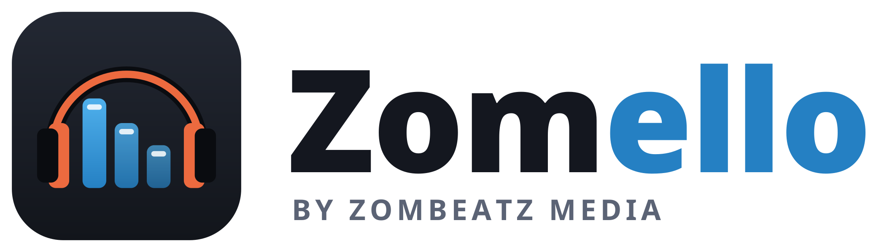
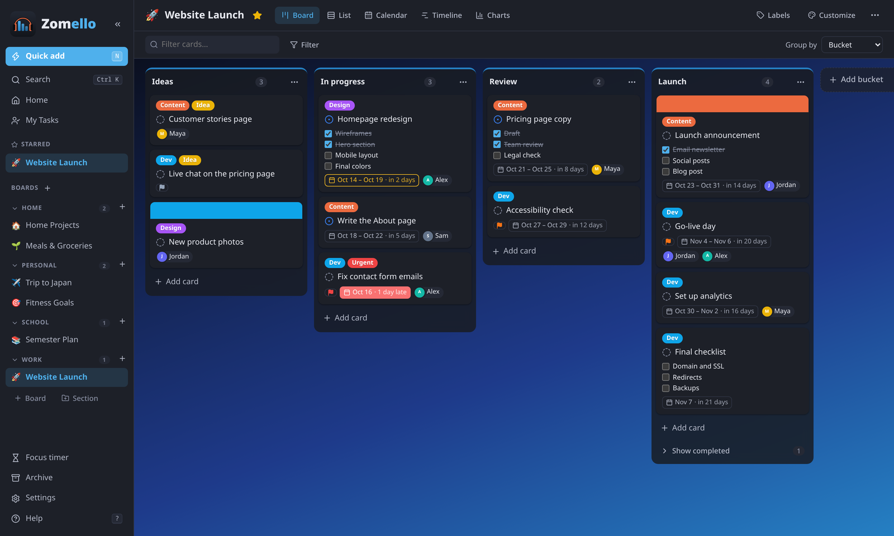
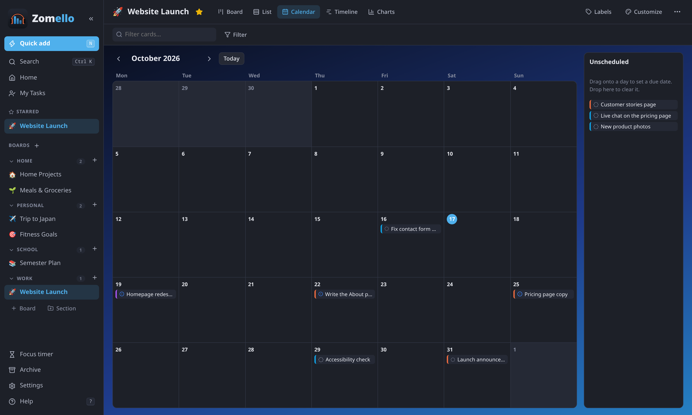
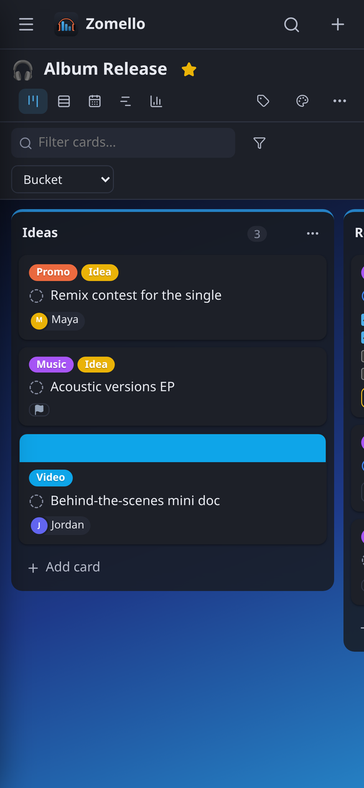
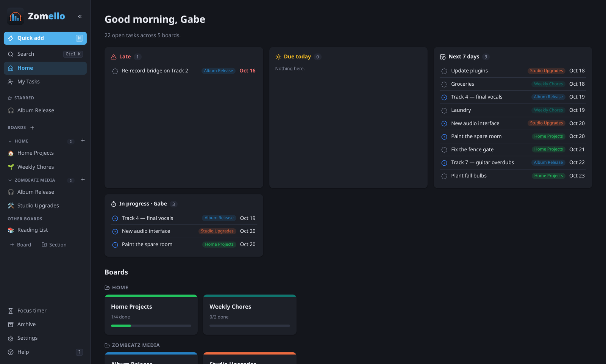

<p align="center">
  <picture>
    <source media="(prefers-color-scheme: dark)" srcset="branding/zomello-logo-dark.png">
    
  </picture>
</p>

<p align="center">
  <b>A planner for any occasion.</b><br>
  A free kanban board and task planner, similar to Trello and Microsoft Planner.<br>
  Use it on Windows, Linux and Android, or self-host it on your own server with Docker.
</p>

<p align="center">
  <a href="https://github.com/ZomBeatz/Zomello/releases/latest"></a>
  <a href="https://github.com/ZomBeatz/Zomello/releases/latest"></a>
  <a href="https://github.com/ZomBeatz/Zomello/releases/latest"></a>
  <a href="https://docs.zombeatzmedia.com/zomello/"></a>
  <a href="https://zombeatz.github.io/Zomello/"></a>
  <a href="https://docs.zombeatzmedia.com/zomello/help-test"></a>
  <a href="#zomello-server"></a>
</p>

<p align="center">
  
</p>

## Quick start

**Just want to look around?** Try the [online demo](https://zombeatz.github.io/Zomello/) in your browser. Nothing to install, and your changes only stay in your own browser.

**Want to help test?** [Join the Zomello beta](https://docs.zombeatzmedia.com/zomello/help-test) and test it on Android, iPhone or iPad before it reaches the app stores.

1. **Download** the file for your device from the [latest release](https://github.com/ZomBeatz/Zomello/releases/latest) (under **Assets** at the bottom):

   | Your device | File to download | Then |
   |---|---|---|
   | **Windows 10/11** | `Zomello_(version)_x64-setup.exe` | Open it. If Windows says *"Windows protected your PC"*, click **More info > Run anyway**. |
   | **Linux** | `.deb` (Ubuntu, Mint, Debian), `.rpm` (Fedora, openSUSE) or `.AppImage` (any) | Open it with your software installer. For the AppImage: right-click > Properties > allow running, then open it. |
   | **Android** | `Zomello.apk` | Open it on the phone and allow installing from your browser or Files app when asked. |

2. **Open Zomello.** A *Getting started* board walks you through the basics.
3. No account or sign-up needed. Your boards are saved on your own device.

If you want several people working on the same boards, see [Zomello Server](#zomello-server).

## What it does

Zomello works a lot like Trello or Microsoft Planner, except it runs on your own devices and your data stays with you.

| | |
|---|---|
| **Boards and cards** | Drag cards between columns like To do, Doing and Done. Group your boards into sections like Work and Home. |
| **Task details** | Checklists, due dates, priorities, labels, people, notes, files and pictures, reminders and repeating tasks. |
| **Views** | Board, list, calendar, timeline and charts. The Home page shows what's late, due today and coming up. |
| **Phone and computer** | The Android app has its own boards, and when it's on the same Wi-Fi it can open your computer's boards too. The connection is encrypted. |
| **Sharing a board** | Drag a board from your computer to your phone (or back), copy and paste cards between devices, or save a board as a `.zomello` file and send it by email or chat. |
| **Zomello Server** | For a team or family: accounts, shared boards, live updates and an Admin page. Runs on a PC, NAS, Raspberry Pi or in Docker. |
| **Customizing** | Themes, colors, backgrounds and icons. There's also a focus timer, time tracking, and undo. |
| **Privacy** | No ads, no tracking and no cloud account. Backups are made automatically. |

<table>
  <tr>
    <td width="66%"></td>
    <td rowspan="2" width="34%"></td>
  </tr>
  <tr>
    <td></td>
  </tr>
</table>

<details>
<summary><b>The full feature list</b></summary>

- **Boards > buckets > cards** with drag-and-drop, WIP limits, collapsible buckets, Planner-style
  "Completed" section under each bucket
- **Rich cards**: Markdown description and notes with a formatting toolbar (code blocks get a Copy button), checklist (items can link to / spin off into tasks on any
  board), labels, priority, progress, start/due dates, assignees, reminders, cover color or image
  (strip or full card), duplicate, move to another board
- **Files**: attach files (button or drag-and-drop); they are copied into Zomello's own storage; images get
  thumbnails and can be card covers. Links and local paths work too
- **Linked tasks** across boards (related / blocks / blocked by) with a Blocked badge
- **Recurring tasks** (daily / weekly on chosen days / monthly / yearly, every N, until a date)
- **Time tracking**: start / pause / resume (one at a time, shown in the sidebar), manual logging, estimates,
  time charts
- **Focus countdown**: 5 to 60 min or custom, from the sidebar or a card (also tracks time on it), with a chime
  and desktop notification
- **Bucket sorting** (due, priority, name, progress, newest, recently updated) that never touches the custom order
- **Custom fields** per board (text, number, dropdown, checkbox, date, link), optionally shown on cards
- **Card display**: each detail can be hidden, an icon, or the full information; card window sections can be hidden
- **Import** boards from Trello (.json) or Microsoft Planner (.xlsx / .csv)
- **AI hand-off** (no AI built in): copy-ready prompts to fill a bucket or plan a whole board with the board's context;
  Markdown exports of a board / bucket / cards with a task (triage bugs, break down, prioritize, status); paste the
  AI's reply back to add cards (with linked sub-tasks), build a board, or update cards, previewed and undoable
- **Sub-tasks**: checklist items linked to cards, parent/sub-task badges and hover highlights, loop prevention,
  "Add to a parent task"; drag to reorder checklists, insert between items, labels on items
- **Spell check** in every text field (system dictionary; on Linux install `hunspell-en_us`)
- **Activity history** on every card (moves, progress, dates, priority, assignment, renames, archive)
- **Card templates** (save from any card; use from "+ Add card", Quick add) and "new board with this layout"
- **Views**: Board · List · Calendar · Timeline · Charts; group the board by bucket, progress, priority,
  assignee, label or due date
- **Home** dashboard and **My Tasks** (everything assigned to you, across boards)
- **Quick add** from anywhere (`N`), global search (`Ctrl+K`), keyboard shortcuts (`?`)
- **Undo / redo** (`Ctrl+Z` / `Ctrl+Shift+Z`) plus Undo buttons on archive/delete toasts
- **Desktop reminders**: per-card reminder times and a daily digest of late / due-today work
- **Customization**: per-board icon, color, background (gradients, colors, your own image), column width,
  compact cards, label style, which badges show, card aging; app-wide accent color, theme, density,
  week start, default view, collapsible sidebar
- **Right-click menu** on cards everywhere
- **Data safety**: atomic writes, automatic rolling backups, JSON export/import, single running instance
</details>

## What people use it for

| | |
|---|---|
| **Home and family** | Chores and cleaning schedules, meal planning and grocery lists, home repairs and renovations, moving house, the family calendar and kids' activities, garden planning |
| **Personal** | Trips and vacations, fitness and health goals, reading, watching and gaming lists, budgets and bills, weddings, parties and other events, hobbies and side projects |
| **School** | Homework and due dates, exam study plans, group projects with classmates, lesson planning for teachers |
| **Work** | Team projects and deadlines, client work for freelancers, small business to-do lists and orders, content calendars for social posts, videos and blogs, bug and feature tracking for software, hiring and onboarding checklists |
| **Groups** | Clubs, churches and volunteer groups, sports teams and coaching, game nights and tabletop campaigns, shared boards for roommates |
| **Creative** | Music releases and studio sessions, writing a book or screenplay, video production and editing |

## Zomello Server

Zomello Server is for a team or family sharing boards. It runs on one always-on computer (a bit like a Plex server),
and everyone signs in from a browser, their phone or the Zomello app.

- Everyone gets their **own account** and boards.
- Boards can be **shared** by invitation, and changes show up **live** for everyone.
- Admins add people, reset passwords and manage boards from the **Admin** page.
- **Daily backups** happen automatically.

**With Docker** (home servers, NAS, Unraid, TrueNAS, Synology, Raspberry Pi 4/5):

```bash
curl -O https://raw.githubusercontent.com/ZomBeatz/Zomello/main/deploy/docker-compose.yml
docker compose up -d
```

Then open `http://<your-server>:7311` and create the admin account.

**Without Docker** (Windows, Linux or macOS): download the `zomello-server` file for your system from the
[latest release](https://github.com/ZomBeatz/Zomello/releases/latest) and open it. Your browser opens to set up the admin account. To start it with the computer,
run it once with `install` (for example `zomello-server-windows-x64.exe install` from an administrator Command Prompt).

The full guide, with https options, backups and password recovery, is in [docs/server.md](docs/server.md). Step-by-step help for everything else is in the [Zomello guide](https://docs.zombeatzmedia.com/zomello/).

## Questions

<details>
<summary><b>Where are my boards saved?</b></summary>

On your own device: `%APPDATA%\com.zombeatz.zomello` on Windows, `~/.local/share/com.zombeatz.zomello` on Linux,
and inside the app on Android. Zomello keeps rolling backups next to them. **Settings > Data** can export everything.
</details>

<details>
<summary><b>How do I see my computer's boards on my phone?</b></summary>

On the computer, open **Settings > Phones & tablets** and follow the steps. Then in the phone app, open
**Settings > Servers > Boards on your computer**. Both have to be on the same Wi-Fi. Details: [docs/apps.md](docs/apps.md).
</details>

<details>
<summary><b>Can I bring my boards from Trello or Planner?</b></summary>

Yes. **Settings > Data > Import** takes Trello exports (`.json`) and Microsoft Planner exports (`.xlsx` / `.csv`).
</details>

<details>
<summary><b>Windows says "Windows protected your PC". Is it safe?</b></summary>

That warning appears for apps that aren't signed with a paid certificate yet. Click **More info > Run anyway**.
The installer is built by GitHub straight from the code in this repository.
</details>

<details>
<summary><b>The window is blank on Linux (NVIDIA / Wayland)</b></summary>

Zomello already works around the common cause. If it still happens, start it with `GDK_BACKEND=x11 zomello`.
</details>

## For developers

<details>
<summary><b>Building and project layout</b></summary>

Built with Tauri 2, React and TypeScript; the server is Rust with SQLite. Needs Node.js 20+ and Rust.

```bash
npm install
npm run app        # dev window with hot reload
npm run bundle     # release bundles > src-tauri/target/release/bundle/ (AppImage, deb, rpm)
npm run android    # build and install on a USB-connected Android phone
npm run server     # build Zomello Server > server/target/release/zomello-server
npm run dev        # browser-only UI at http://localhost:1420 (data in localStorage)
./scripts/install-desktop.sh   # Linux: build and install into the app menu
```

More in [docs/apps.md](docs/apps.md#building-it-yourself).

- `src-tauri/src/` - desktop and Android app (storage, backups, phone & tablet access)
- `src/store.ts` - app state, all changes, undo/redo, autosave
- `src/components/` - pages, card window, views
- `server/` - Zomello Server (Rust, SQLite), `deploy/` - compose file for servers
</details>

## License

[MIT](LICENSE). Icons are [Lucide](https://lucide.dev) (ISC). The names Zomello and ZomBeatz Media and their logos aren't covered by the license.

## Contact

Made by **ZomBeatz Media** · [info@zombeatzmedia.com](mailto:info@zombeatzmedia.com)
